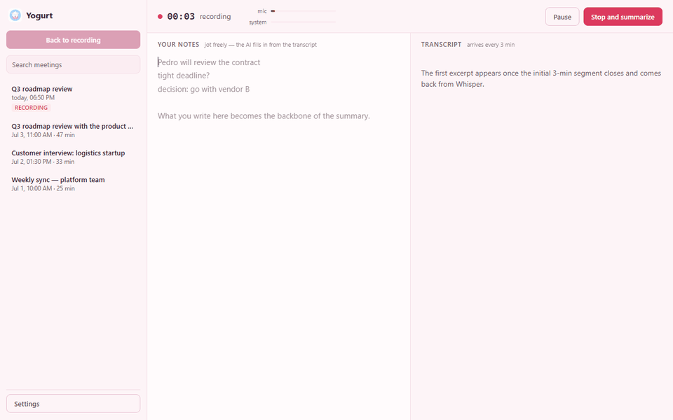
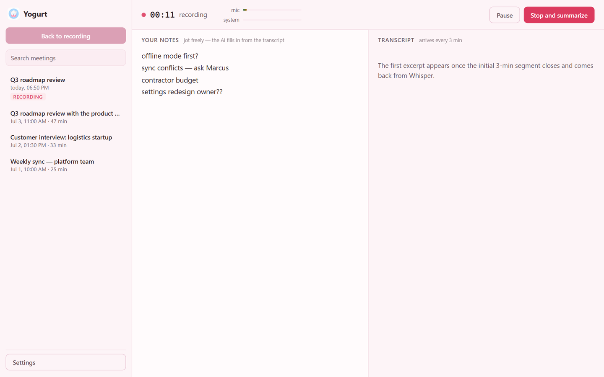
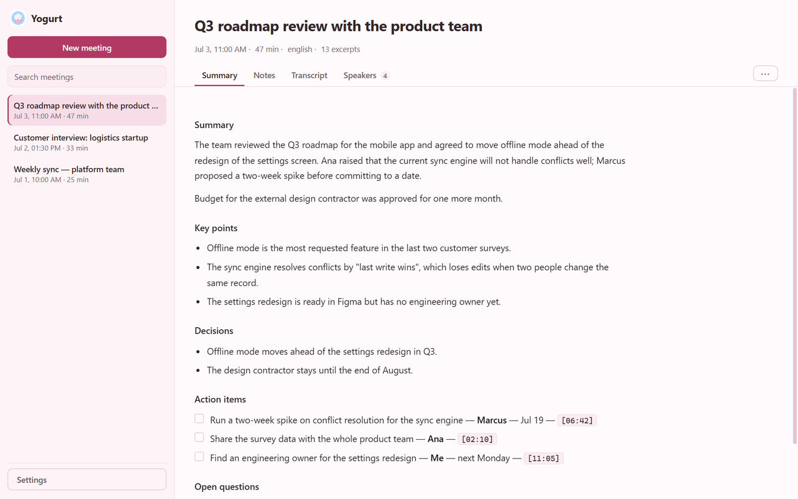
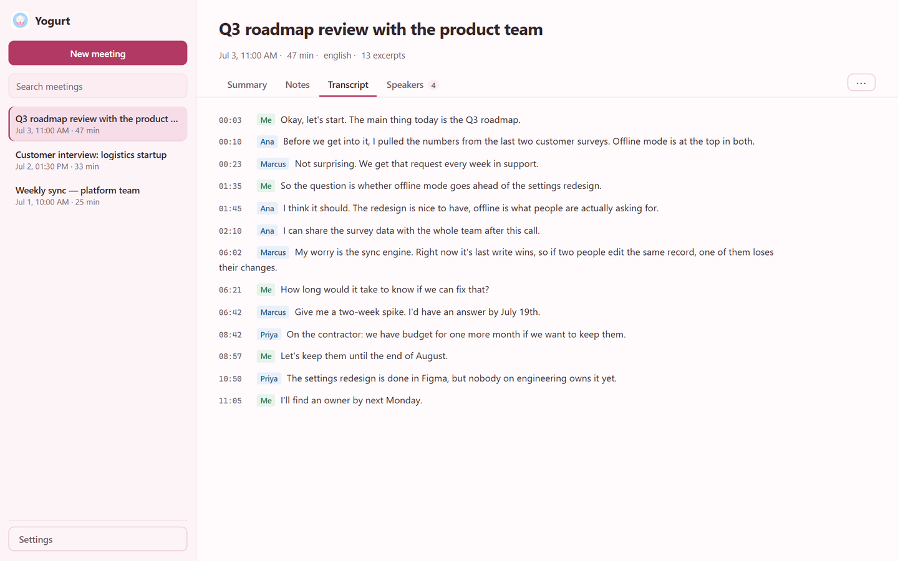
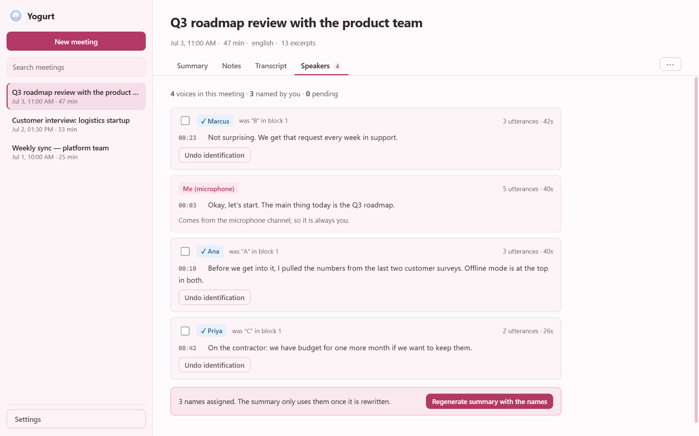

# Yogurt

It's not Granola, it's Yogurt.

Smart meeting notes that run on your own machine. You jot down what matters
during the meeting; Yogurt records the audio, transcribes it with OpenAI's
Whisper, and uses your notes as the backbone for writing complete minutes.

It's the same idea as [Granola](https://www.granola.ai/) (Yogurt is not
affiliated with it), but local: the audio, notes, transcripts and minutes live
as files in your user folder. The only thing that leaves the machine is the
calls to the OpenAI API.

<p align="center">
  
</p>

## Download

Get the Windows installer from the
[**Releases page**](https://github.com/Dimitriose/Yogurt/releases), run it (no
admin rights needed) and enter your OpenAI API key in **Settings**. The
installer isn't code-signed, so Windows shows *"Windows protected your PC"*:
click **More info → Run anyway**.

You need Windows 10 or 11 and an OpenAI API key with credits. The app shows
the cost of each meeting.

**Trying it out?** Feedback is very welcome: open an
[issue](https://github.com/Dimitriose/Yogurt/issues/new/choose) for bugs, or
start a thread in [Discussions](https://github.com/Dimitriose/Yogurt/discussions)
for anything else.

## Screenshots

| Recording: you take notes, Yogurt listens | The summary, built around your notes |
| --- | --- |
|  |  |
| **Transcript with named speakers** | **Naming speakers** |
|  |  |

*Screenshots use a fictional meeting.*

> **Privacy and security:** what goes to OpenAI, what stays on disk and how the
> key is stored are covered in [SECURITY.md](SECURITY.md). Let participants
> know before you record a meeting.

> **Going to touch the code?** Read [MAINTENANCE.md](MAINTENANCE.md) first —
> especially the invariants section. Several constraints here are
> counterintuitive, and "fixing" one of them breaks something far away.

> **Language:** the app ships in English and Portuguese. By default it follows
> the Windows display language; you can change it in **Settings → Meeting → App language**.
> The generated minutes are written in the selected language too.

---

## How it works

```
┌─────────────────────────────────────────────────────────────────┐
│  RENDERER (React)                                               │
│                                                                 │
│   getUserMedia ──────┐                                          │
│   (microphone)       ├──► GainNode ──┐                          │
│                      │               ├──► MONO destination ──► MediaRecorder
│   getDisplayMedia ───┘               │                          │
│   (WASAPI loopback)   GainNode ──────┘         rotates every N min
└──────────────────────────────────────────────────────┬──────────┘
                                                       │ .webm segment
┌──────────────────────────────────────────────────────▼──────────┐
│  MAIN (Node)                                                    │
│   writes to disk ──► Whisper (parallel, per segment)            │
│                        │                                        │
│                        ▼                                        │
│              partial transcript ──► back to the screen, live    │
│                                                                 │
│   on stop: your notes + transcript ──► GPT ──► minutes          │
└─────────────────────────────────────────────────────────────────┘
```

## Meeting detection

When another app starts using the microphone, Yogurt suggests recording; when
it lets go, Yogurt suggests stopping. **It suggests — it never decides on its
own.**

The source is Windows' microphone usage registry
(`HKCU\...\CapabilityAccessManager\ConsentStore\microphone`), the same one that
feeds the Windows 11 privacy indicator. Each app has `LastUsedTimeStart` and
`LastUsedTimeStop`; while the session is open, `LastUsedTimeStop` is `0`.
Nothing is listened to and no other process is inspected.

Verified in practice before building: opening the microphone makes the key
appear with `0x0` within seconds, and releasing it clears it. The whole query
via `reg.exe` costs ~60 ms, feasible to poll every 5s (PowerShell would be far
too heavy).

Three decisions that came from stumbles:

**The 25s grace period before suggesting to stop.** Switching audio devices, or
the meeting app reopening its session, releases the microphone for a few
seconds. Suggesting to stop during that gap would be worse than waiting.

**Only our own executable is excluded**, by the process's real basename. The
first version excluded `electron.exe` and `yogurt.exe` as hard-coded names —
which would have made the app ignore any Electron-based meeting app. Side
effect: running in development, where we are `electron.exe`, another Electron
app can't be told apart from us. In the packaged build we are `Yogurt.exe` and
the distinction exists — that's how the end-to-end test passed.

**The suggestion isn't repeated** while the same set of apps holds the
microphone. Re-emitting it on every 5s scan would be intolerable.

## Silence skipping

A silent channel costs the same as one full of speech, and with channel
separation that happens often: in a meeting where you talk 20% of the time, the
microphone channel is 80% silence. `AudioEngine` tracks the peak RMS of each
channel during the segment; below ~-46 dBFS the segment goes to disk but
**not** to the API. `Retranscribe` still works, because the file is there.

The detail that almost slipped by: the measurement uses `setInterval`, not
`requestAnimationFrame`. rAF depends on compositing and **stops firing when the
window is hidden in the tray** — measuring with it would make every segment look
silent while the app is minimized, and the whole meeting would go untranscribed.

## System tray

Closing the window hides it in the tray; an ongoing recording is **not**
interrupted. To really quit, right-click the icon → *Quit Yogurt*. This can be
turned off in Settings → Meeting → Window.

The icon gets a red dot while recording, and the tooltip shows the elapsed time
(updated every 5s — the screen uses 250ms, but sending that to the main process
four times per second would be wasteful).

Three non-obvious details:

**`backgroundThrottling: false` is mandatory here.** Chromium throttles timers
of background windows, down to about one firing per minute after a few minutes.
Since segment rotation is a `setTimeout` of several minutes, hiding the window
would delay closing segments and misalign the timestamps — the tray would break
the recording instead of protecting it.

**The discard confirmation lives in two places, and it has to.** With the tray
on, the X only hides the window and nothing is lost, so `before-quit` does the
confirming. With the tray off, the X quits — and then the confirmation has to
come from the close handler, **before** the window is destroyed. Leaving it only
in `before-quit` would be too late: the renderer doing the recording would
already be dead, and cancelling would leave the app alive with no window at
all.

**Both icon variants are ready-made files**, generated outside the runtime
(`resources/tray.png`, `resources/tray-recording.png`). Compositing the image at
runtime would require a PNG decoder in the main process, which Node doesn't
ship.

While recording, the app also blocks display sleep via `powerSaveBlocker` — the
machine going to sleep mid-meeting would kill the capture, and hiding in the
tray makes that more likely.

## Theme

Palette taken from the icon: yogurt cream for the background, fruit-pulp pink
for interaction states, strawberry as the accent, and the label's blue for
anything informational. All of it lives in tokens at the top of
[styles.css](src/renderer/src/styles.css).

**Two pinks in separate roles, on purpose.** The pastel one (`--pink-soft`,
`--pink-band`) is decorative: selected-item background, bands, tags. The strong
one (`--accent`) is the only one that carries white text or becomes a link —
because pastel pink on cream doesn't get past ~3:1 contrast. Pretty as a fill,
illegible as a word.

The text values were calculated, not picked by eye: measured against
`--bg-active`, the darkest background in the interface (the selected item in
the list), which is where secondary text is tightest. All 24
foreground/background pairs pass WCAG AA. A first version of the palette failed
4 of them, including the link pink — hence checking beats eyeballing.

## Timestamped notes

Each note line stores the moment in the meeting when it **started** being
written. The value isn't the time itself: it's that a note comments on what was
being said at that moment, so aligning notes with the transcript gives the
model a much stronger signal than sending the notes as a loose block.

In the prompt, the notes are **interleaved** into the transcript:

```
[04:10] Speaker A: ...the contract expires in March, and then we need to renegotiate
[04:12] >>> USER NOTE: Pedro will review the contract
[04:18] Speaker B: ...
```

Two subtleties solved in [notes.ts](src/shared/notes.ts), both covered by
tests:

- **Progressive typing.** Each save sees the line a little longer. Comparing by
  equality, it would look new on every keystroke and the timestamp would move
  along with it — recording when the user *finished*, not when the topic was in
  the air.
- **Later correction.** Fixing a typo in a note from five minutes ago must not
  pull its timestamp into the present.

Both cases come from the same mechanism: accepting a prefix relationship
between the old and new line, in addition to exact equality.

The turn grouping used in the interleaved prompt is shorter than the on-screen
one (15s versus 40s). A turn is positioned by its start, so a note written in
the middle of it would show up after the whole block. Measured on the real
transcript of a test: with the 40s window the average offset was 15s (worst
case 25s); with 15s it drops to 3.3s (worst 4.5s), and below that it doesn't
improve — it just fragments.

The timestamps are kept in `notes.timeline.json`, separate from `notes.md`, so
the text stays plain and readable outside the app. Losing the timeline doesn't
lose the notes.

**Why segments.** The Whisper API accepts at most 25 MB per file. Recording in
segments of a few minutes solves the limit and, as a bonus, allows
transcribing during the meeting — by the time you click "stop", almost
everything is already done. Each segment is a complete WebM, so we rotate the
whole `MediaRecorder` instead of slicing the stream with `timeslice`
(intermediate chunks have no EBML header and Whisper would reject them).

**Why system audio and not the meeting window.** Chromium's `getDisplayMedia`
on Windows only delivers audio from a tab. The main process intercepts the
request in [src/main/index.ts](src/main/index.ts) and responds with
`audio: 'loopback'`, which turns on WASAPI capture of the default output device
— everything coming out of the speakers, regardless of the app. Teams, Meet,
Zoom and a phone on speaker all work the same. The video track is mandatory in
the API's response, but the renderer discards it immediately: **no screen image
is recorded.**

**Why the channels are kept separate rather than mixed.** The microphone is, by
construction, always the person using the app. Recording mic and system into
separate files makes that attribution free: lines from the microphone channel
come out labelled **"Me"** without relying on diarization, without spending one
of the 4 voice references, and with no chance of error. The system channel then
contains only the remote participants, which also makes it easier to tell them
apart.

A nice consequence: **even with speaker identification turned off** you
already get "Me" vs "Others", at no extra model cost.

The two recorders rotate on the same tick and share the time accounting — that's
what keeps the timestamps aligned when the two transcripts are interleaved by
absolute time.

**Why the microphone has echo cancellation.** Remote voices already arrive clean
through the loopback. With `echoCancellation: true`, Chromium removes them from
the microphone channel using the output signal itself as a reference. Without
it, anyone listening through speakers would record every line twice — and,
worse now, the "Me" channel would be contaminated with other people's voices,
destroying the attribution.

**Why the OpenAI calls don't use Node's `fetch`.** Node's `fetch` (undici)
validates certificates against the CA bundle compiled into Node itself and
ignores the system store. On any network with TLS inspection — the target
environment for this app — every call dies with `SELF_SIGNED_CERT_IN_CHAIN`.
The client is configured with [chromiumFetch](src/main/chromiumFetch.ts), which
uses `net.fetch`: the Chromium stack trusts the Windows certificate store and
honours the system proxy, both for free.

That took two workarounds, both verified against the real API before going in:

| Symptom | Cause | Fix |
| --- | --- | --- |
| `ERR_INVALID_ARGUMENT` on upload | `net.fetch` doesn't accept a streaming body, and the SDK builds the multipart as a stream | consume the stream and send it buffered (1–2 MB per segment) |
| `ERR_INVALID_ARGUMENT` on every POST | the SDK sets `content-length`, a forbidden header that browsers silently drop but `net.fetch` rejects | remove the header and let Chromium recompute it |

---

## Running

```powershell
npm install
npm run dev
```

### Corporate network with TLS inspection

If your network uses a proxy that intercepts TLS, `npm install` fails with
`SELF_SIGNED_CERT_IN_CHAIN`: the registry's chain is signed by the corporate
CA, which Node doesn't include in its own bundle. The fix is to make Node use
the Windows certificate store, where the CA is already installed by IT policy —
**only for the install command**:

```powershell
$env:NODE_OPTIONS = '--use-system-ca'   # Node 22.15+ / 24+
npm install
$env:NODE_OPTIONS = ''                  # clear it before running the app
```

⚠️ **Don't** leave `NODE_OPTIONS` set permanently: Electron rejects
`--use-system-ca` in `NODE_OPTIONS` and exits with code 9, so `npm run dev`
stops working. If you want something permanent, the way is to export the root
CA from the Windows store and point `npm config set cafile <file.pem>` at it,
which affects only npm.

**Don't** use `npm config set strict-ssl false` or
`NODE_TLS_REJECT_UNAUTHORIZED=0`: both fix the symptom by turning off
certificate verification entirely, on a machine that downloads and runs code
from the internet.

**Running the app from a terminal opened by VSCode:** the extension host exports
`ELECTRON_RUN_AS_NODE=1`, which makes the Electron binary run as plain Node —
the app doesn't open and `require('electron')` returns a string instead of the
API. Clear the variable first:

```powershell
Remove-Item env:ELECTRON_RUN_AS_NODE -ErrorAction SilentlyContinue
npm run dev
```

On first run, open **Settings** and paste your OpenAI API key. It is encrypted
with Windows DPAPI (`safeStorage`) and stored in
`%APPDATA%\Yogurt\settings.json` — it never reaches the renderer in plain text.

Other scripts: `npm run typecheck`, `npm run build`, `npm start` (preview of
the build).

## Installing on another machine

```powershell
$env:NODE_OPTIONS = '--use-system-ca'
npm run dist                 # → release/Yogurt-0.5.0-setup.exe
$env:NODE_OPTIONS = ''
```

Copy the `.exe` to the other machine and run it. The installer is a per-user
NSIS installer (`perMachine: false`), so it **doesn't need admin** — relevant on
a corporate machine with restricted permissions.

### What doesn't come along

| | |
| --- | --- |
| **OpenAI key** | Has to be entered again. It's encrypted with Windows DPAPI, tied to the user account on **that** machine — copying `settings.json` doesn't work, and that's the intended behaviour. |
| **Meetings** | Live in `%APPDATA%\Yogurt\meetings\`. To take them along, copy the folder; they're ordinary files. |

### The SmartScreen warning

The installer isn't signed, so Windows shows *"Windows protected your PC"* on
first run — you need to click **More info → Run anyway**. On a machine with a
corporate blocking policy, it may be blocked outright; then the way forward is
code signing with a company certificate (`win.certificateFile` in
`electron-builder.yml`).

### Why `signAndEditExecutable: false`

The build doesn't pass without it on this machine, and the reason is quite
indirect: the step that signs/edits the executable downloads the `winCodeSign`
toolchain, whose package contains **macOS symlinks** (`libcrypto.dylib`,
`libssl.dylib`). Creating a symlink on Windows requires
`SeCreateSymbolicLinkPrivilege`, which a regular user account doesn't have, so
extraction fails and the build dies — **even with no intention of signing
anything**. The error doesn't obviously mention signing or permissions; it talks
about `.dylib`, which sends you investigating in the wrong direction.

Worth noting that the corporate network was **not** the problem: the downloads
finished in under 1s.

Consequence: electron-builder no longer embeds the icon and metadata (version,
product name) in the `.exe` — and the desktop shortcut, which points to the
`.exe`, showed the default Electron icon. The embedding is now done by the
[build/afterPack.cjs](build/afterPack.cjs) hook, using the `rcedit` npm package:
it's the same binary electron-builder would use, but distributed without
symlinks.

### Icon

`build/icon.png` (1024², transparent background) is the source of the installer
icon; `build/icon.ico` is what the `afterPack` hook embeds in `Yogurt.exe`, and
therefore what shows up in Explorer and in shortcuts. The window loads
`resources/icon.png` at runtime (declared in `extraResources` and resolved in
[index.ts](src/main/index.ts) via `process.resourcesPath`). When changing the
logo, update all three.

### One meeting, two builds

The packaged app and the development one share `%APPDATA%\Yogurt`, because the
`appId` and `productName` are the same. Running both on the same machine means
the same meeting library and the same key — convenient for testing, but they're
not isolated installations.

---

## Where the data lives

One folder per meeting, in `%APPDATA%\Yogurt\meetings\<id>\`:

| File              | Contents                                        |
| ----------------- | ----------------------------------------------- |
| `meta.json`       | title, dates, duration, status, speaker names   |
| `notes.md`        | what **you** typed during the meeting           |
| `transcript.json` | lines with absolute timestamps and channel      |
| `summary.md`      | the generated minutes                           |
| `audio/seg-NNNN-mic.webm` | your microphone                         |
| `audio/seg-NNNN-system.webm` | the remote participants              |

Meetings recorded before channel separation have `seg-NNNN.webm` with no suffix
(mixed audio); `Retranscribe` recognises both formats and doesn't assign "Me"
or "Others" to the old audio, because there the source is unrecoverable.

The names you give speakers are stored in `meta.json` (`speakerNames`), not in
the transcript: the transcript stays as the API returned it, and naming is a
layer on top — reversible, and applicable to the minutes without
retranscribing.

No SQLite, on purpose: zero native modules to compile, trivial backup and sync
(OneDrive, Dropbox), and the content stays readable if you uninstall the app.
If the library grows to the point where listing gets slow, the way forward is a
SQLite index on top of these files — not replacing them.

The **Open folder** button on the meeting screen takes you straight there.

---

## Cost per meeting

Estimate for a 1-hour meeting, at OpenAI's reference prices:

| Item                          | Approx.    |
| ----------------------------- | ---------- |
| Whisper (US$ 0.006/min)       | ~US$ 0.36  |
| Minutes with `gpt-4o`         | ~US$ 0.08  |
| **Total**                     | **~US$ 0.45** |

### Cost by configuration

All three transcription rates are identical — `whisper-1`,
`gpt-4o-transcribe` and `gpt-4o-transcribe-diarize` cost **$0.006/min**. So
the chosen model doesn't change the bill; what changes it is the **number of
channels**.

With speaker identification on, the "Transcription" setting governs only the
microphone channel; the system channel uses the diarization model regardless:

| | without identification | with identification |
| --- | --- | --- |
| microphone | whisper-1 $0.006/min | whisper-1 $0.006/min |
| system | whisper-1 $0.006/min | diarize $0.006/min |
| **transcription** | **$0.012/min** | **$0.012/min** |

In a 1-hour meeting, at the speech density measured in real use (~160
words/min): transcription $0.72 + minutes with gpt-4o $0.057 + title generation
$0.005 ≈ **$0.78**. Transcription is 92% of the bill, so switching the minutes
to `gpt-4o-mini` saves five cents per hour — the money is in the audio minutes,
which is why silence skipping matters more than the choice of model.

The diarization model's `$0.006/min` is an OpenAI **estimate** for normal
speaking cadence; actual billing is per token, and `diarized_json` spends
output on `speaker`/`start`/`end` for every line. Dense conversation in
Portuguese can go above that. Each diarized block logs the actual tokens
(`[openai] diarization block N: …`), which closes that gap with measurement.

To cut costs: switch the minutes to `gpt-4o-mini` in Settings (~5× cheaper) and
increase the segment size — larger segments mean fewer transcription calls, at
the cost of text taking longer to appear on screen.

### The minutes model: choose by TPM, not by price

Since version 0.3.0 the default minutes model is **`gpt-5.6-luna`**, and the
reason isn't price — it's the **tokens-per-minute ceiling**, which belongs to
the *account* and is **per model**:

| | gpt-4o | gpt-5.6-luna |
| --- | --- | --- |
| TPM (first tier) | 30,000 | 200,000 |
| Meeting that fits without condensing | **~94 min** | ~10 h |

Going over the ceiling gives no advance warning: the request comes back with
`429 Request too large` and the minutes aren't produced. It happened in a real
98-minute meeting, which went over gpt-4o's limit by 4.7%.

When the transcript doesn't fit, Yogurt **condenses** it in parts before
sending. That preserves the content, but undoes the fine-grained alignment of
the notes — precisely what sets the app apart. In other words: a model with a
low TPM doesn't just fail at the extremes, it degrades the minutes in any long
meeting.

If your account has a higher tier, enter the value in **Settings → Meeting →
Tokens per minute (TPM)**. Yogurt also reads the actual limit from the API's error
message and adopts it on its own when it finds one.

Luna's price isn't filled in yet in the catalogue (`shared/models.ts`), so its
estimates show up as **"up to US$ X"**, calculated with the gpt-4o rate — a
ceiling, not an estimate.

---

## Speaker identification

Optional, off by default. When turned on in Settings, transcription switches to
`gpt-4o-transcribe-diarize` with `response_format: 'diarized_json'`, and every
line comes with a speaker label.

The flow closes the identity loop:

1. In the first meeting, speakers come out as anonymous letters (`A`, `B`, …).
2. In the **Speakers** tab you give each voice a name. Yogurt picks that
   speaker's line closest to 5s, cuts it, resamples it to 16 kHz mono and saves
   it as a voice profile in `<userData>/speakers/`.
3. In subsequent meetings the profiles are sent as `known_speaker_names[]` +
   `known_speaker_references[]`, and speakers arrive **already named**.

**The central gotcha: anonymous labels are scoped per request.** Because we
record in segments, the `A` in segment 1 isn't necessarily the `A` in segment
2. The UI shows the block next to the label (`A·1`, `A·2`) and the minutes
prompt is explicitly instructed never to merge labels from different blocks —
it only uses a name when the dialogue itself reveals who it is. Naming the voice
once solves this for good in subsequent meetings.

| Limit | Value |
| --- | --- |
| Active nameable voices | **4** (API limit) |
| Reference clip | 2–10s; we aim for ~5s |
| Audio > 30s | requires `chunking_strategy: 'auto'` |
| Model window / output | 16k context, 2k output tokens |
| `prompt` | not supported by this model |

Anonymous labels are **per request**: the `A` in block 1 may not be the `A` in
block 2. Naming is always per meeting, in the Speakers tab — and you can select
several cards that are the same person and name them all at once.

### Overlapping speech and turn grouping

Diarization captures overlapping speech faithfully, and the raw result is
unreadable. A "for sure" said over someone who is talking arrives like this:

```
[A] For
[B] It's
[A] sure.
[B] simply a question of the stage of life,
```

[coalesceTurns](src/shared/transcript.ts) regroups by speaker. Measured on the
real transcript of a 5.4-minute test: **83 lines → 19 turns**, without losing a
word and without breaking chronological order.

The first version used only a 3s silence window and got worse in a different
way: a dominant speaker became **one 195s, 499-word turn**, and the other
person's interjections that happened *within* that interval appeared after it,
making the reading order misleading. That's why grouping has three limits — a
1s window (only rejoins real fragments), a 40s cap and a 120-word cap.

Grouping applies to the screen **and** to the minutes prompt; choppy text
degrades the summary. But the span of a grouped turn crosses the other
participant's speech, so cutting a voice clip always uses the **raw lines** —
otherwise the reference would come out contaminated with the wrong voice.

## Known limitations

**Diarization can't distinguish people on the same microphone.** If two people
speak into the same input in a room, the model may separate them by timbre, but
the channel doesn't help — both count as "Me".

**Diarization quality in Brazilian Portuguese hasn't been measured.** whisper-1
was validated in real use; the diarization model wasn't. That's why the option
is opt-in rather than the default — turn it on, compare, decide.

**macOS.** `audio: 'loopback'` is Windows-specific. On macOS, system capture
requires a virtual audio device (BlackHole, Loopback) selected as the output,
and the app would capture it as a microphone. The code doesn't handle that path
yet.

**Interrupted meeting.** If the app closes in the middle of a recording, the
segments already closed stay on disk. The next time it opens, the meeting shows
up with an error and the **Retranscribe** button processes the saved audio and
writes the minutes. The segment in progress at the moment of closing is lost.

**Network failure during the meeting.** Each segment is independent: if one
fails, the others continue and a warning appears on screen. **Retranscribe**
reprocesses everything from scratch from the audio on disk.

---

## Structure

```
src/
├─ main/                  main process (Node)
│  ├─ index.ts            window, loopback handler, permissions
│  ├─ ipc.ts              IPC handlers
│  ├─ meetings.ts         orchestrates transcription and minutes generation
│  ├─ openai.ts           Whisper/diarization + GPT, with map-reduce for long transcripts
│  ├─ chromiumFetch.ts    transport via Chromium (corporate TLS + proxy)
│  ├─ speakers.ts         persisted voice profiles
│  ├─ prompts.ts          the prompts (this is where you tune the minutes' tone)
│  ├─ store.ts            file-based persistence
│  └─ settings.ts         preferences + encrypted key
├─ preload/index.ts       contextIsolation bridge → window.yogurt
├─ shared/
│  ├─ types.ts            shared types
│  └─ api.ts              bridge contract (without importing electron)
└─ renderer/src/
   ├─ audio/AudioEngine.ts   capture, mixing and segmentation
   ├─ hooks/useRecorder.ts   recording state
   ├─ views/                 recording, meeting, speakers, settings
   └─ components/Markdown.tsx minimal renderer (no HTML, no injection)
```

To change the format or tone of the minutes, the file is
[src/main/prompts.ts](src/main/prompts.ts) — `SUMMARY_SYSTEM` defines the
sections and the rules. To add company vocabulary without editing code, use
**Instructions for the summary** in Settings.

---

## License

[MIT](LICENSE).
